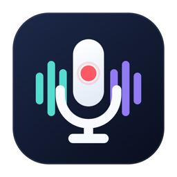

<p align="center">
  
</p>

<h1 align="center">DuoRec</h1>

<p align="center"><strong>Your Mac's audio. Your voice. Recorded together.</strong></p>
<p align="center">System audio + microphone recording for macOS · Single-file MP4 · On-device Mandarin transcription</p>

<p align="center"><a href="README.md">简体中文</a> · English</p>

<p align="center">
  <a href="#get-started">Get started</a> ·
  <a href="docs/USER_GUIDE.md">User guide (Chinese)</a> ·
  <a href="docs/DEVELOPMENT.md">Build &amp; development (Chinese)</a>
</p>

---

## What is DuoRec?

In an online meeting, a remote interview, or a study session with spoken notes, you may want to capture both **the audio playing on your Mac** and **your own microphone**. DuoRec records both at once, so you can listen back and transcribe each source separately.

It is a lightweight, native Mac app. Start recording from the window or menu bar, and keep the files on your Mac. Recording and transcription run locally, with no API key required.

| What it does | How it helps |
| --- | --- |
| **Records both audio sources** | Capture system audio and your chosen microphone together. Separate live meters help you check both inputs. |
| **One MP4 for playback and transcription** | Listen to a mix of both inputs, or transcribe the independent source tracks. Move or rename the file without a companion file. |
| **Organizes text by source** | View Mandarin transcripts in time order, labeled “System Audio” and “Microphone.” Filter, select, and copy the text you need. |
| **Saves locally and attempts recovery** | Choose a save folder, let the app finish saving before it quits, and attempt recovery after an unexpected interruption. |

## Get started

Requires **macOS 26+**. [Download the macOS app](https://github.com/Frant1cc/DuoRec/releases/latest) to use DuoRec without Xcode. The universal build includes Apple silicon and Intel binaries; transcription still requires a device that supports the system model.

Download `DuoRec-1.0.0-macOS-universal.dmg`, open it, and drag `DuoRec.app` into **Applications**. Launch it from there. Alternatively, download the ZIP, extract it, and move the app into Applications.

The current build is not Developer ID signed or notarized by Apple. If macOS blocks the first launch and you trust the download source, follow [Apple's instructions](https://support.apple.com/en-us/102445): open **System Settings > Privacy & Security > Open Anyway**.

<details>
<summary>Build from source (requires a full installation of Xcode 26+)</summary>


```sh
git clone https://github.com/Frant1cc/DuoRec.git
cd DuoRec
open DuoRec.xcodeproj
```

In Xcode, select the `DuoRec` scheme and `My Mac`. Under `Signing & Capabilities`, choose `Sign to Run Locally` or your own development team, then press **⌘R** to run.

You can also [build from the command line](docs/DEVELOPMENT.md#使用命令行) (instructions in Chinese). The app interface supports Simplified Chinese and English.

</details>

## Record in three steps

1. **Grant access** — Allow screen and system audio recording and microphone access when prompted. If macOS asks you to restart the app, quit it completely and reopen it.
2. **Check your inputs** — Choose a microphone and click **Test Input**. Play some audio and speak into the microphone to check that both meters respond.
3. **Record and save** — Click **Start Recording**, then **Stop and Save** when you are done. Recordings go to `Downloads/DuoRec` by default; you can choose another folder.

Each recording is saved as **one audio-only `.mp4` file**. Open it to hear a mix of system audio and your microphone. Independent source tracks are kept in the same file for separate transcription later.

Use headphones to keep speaker audio from being recorded again through your microphone.

## Turn recordings into text

Click **Transcribe Recording** and choose your recorded MP4 to get a transcript in time order, labeled by audio source. The app transcribes the source tracks separately and skips the mix to avoid duplicate text. Filter by **System Audio** or **Microphone**, then copy the passages you need for meeting notes, interview write-ups, or study notes.

You can also import ordinary single-track audio. Transcription currently supports **Mandarin Chinese**, even when the interface is in English. Your device must support the required macOS model, which may need to be downloaded on first use. Source labels distinguish the two inputs; they do not identify different speakers within the same input.

Transcript history is not saved. Copy any text you need before closing the transcription window. Older M4A recordings with matching source files can still be imported; see the [user guide](docs/USER_GUIDE.md) (Chinese) for details.

## Learn more

- [User guide](docs/USER_GUIDE.md) (Chinese): permissions, file formats, privacy, recovery, and troubleshooting.
- [Build & development](docs/DEVELOPMENT.md) (Chinese): full build instructions, requirements, and regression checks.
- [Report an issue](https://github.com/Frant1cc/DuoRec/issues): feedback and pull requests are welcome.

DuoRec is open source under the [MIT License](LICENSE).
