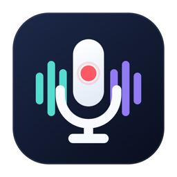

<p align="center">
  
</p>

<h1 align="center">DuoRec</h1>

<p align="center"><strong>电脑的声音，你的声音，一起记下来。</strong></p>
<p align="center">macOS 双路录音 · 单文件 MP4 · 本机普通话转写</p>

<p align="center">简体中文 · <a href="README.en.md">English</a></p>

<p align="center">
  <a href="#开始使用">开始使用</a> ·
  <a href="docs/USER_GUIDE.md">使用指南</a> ·
  <a href="docs/DEVELOPMENT.md">构建与开发</a>
</p>

---

## DuoRec 是什么？

开线上会议、做远程访谈，或边听课程边口述想法时，你往往需要同时留下**电脑里播放的声音**和**自己对着麦克风说的话**。DuoRec 可以一次录下这两路声音，方便回听，之后再按来源转成文字。

它是一个轻量的原生 Mac 应用：在窗口或菜单栏开始录音，结束后文件留在本机。无需 API Key，录音与转写都在本机处理。

| 能做什么 | 对你有什么用 |
| --- | --- |
| **同时录两路声音** | 系统声音与所选麦克风一起录，实时电平方便确认两路输入。 |
| **一个 MP4，回听与转写都保留** | 默认播放两路声音的混音，独立来源音轨供分开转写；移动或改名无需配套文件。 |
| **按来源整理文字** | 普通话转写按时间排列，标明“系统声音”和“麦克风”，可筛选、选中和复制。 |
| **本机保存与恢复** | 自选保存位置，退出时等待保存，意外中断后尝试恢复。 |

## 开始使用

需要 **macOS 26+**。可以直接[下载 macOS 应用](https://github.com/Frant1cc/DuoRec/releases/latest)，无需安装 Xcode。通用安装包包含 Apple 芯片与 Intel 版本；转写功能仍需设备支持对应的系统模型。

下载 `DuoRec-1.0.0-macOS-universal.dmg`，打开后将 `DuoRec.app` 拖入“应用程序”，再从那里启动。也可下载 ZIP，解压后将 App 移至“应用程序”。

当前安装包未使用 Apple Developer ID 签名和公证。首次打开若被系统拦截，仅在确认下载来源可信时，按 [Apple 的说明](https://support.apple.com/zh-cn/102445)，在“系统设置 > 隐私与安全性”中选择“仍要打开”。

<details>
<summary>从源码构建（需要完整安装 Xcode 26+）</summary>


```sh
git clone https://github.com/Frant1cc/DuoRec.git
cd DuoRec
open DuoRec.xcodeproj
```

在 Xcode 中选择 `DuoRec` Scheme 和 `My Mac`，在 `Signing & Capabilities` 中选择 `Sign to Run Locally` 或自己的开发团队，按 **⌘R** 运行。

也可以使用[命令行构建](docs/DEVELOPMENT.md#使用命令行)。界面支持简体中文和英语。

</details>

## 三步录下声音

1. **授予权限** — 启动后允许“屏幕与系统音频录制”和“麦克风”访问；若系统要求，完全退出后重新打开。
2. **确认输入** — 选择麦克风，点击“测试输入”，确认系统声音与麦克风两条电平都会变化。
3. **开始与保存** — 点击“开始录音”，结束后“停止并保存”。默认保存到 `下载/DuoRec`，也可更换文件夹。

每次录音保存为**一个仅含音频的 `.mp4` 文件**。直接打开即可回听系统声音与麦克风的混音，文件内同时保留独立来源音轨，方便后续分别转写。

建议佩戴耳机，避免扬声器的声音被麦克风再次录入。

## 把录音变成文字

点击 **“导入录音转文字”**，选择录制的 MP4，即可得到按时间排列、带声音来源标记的文字。应用分别识别来源音轨，跳过混音轨，避免重复转写。筛选“系统声音”或“麦克风”，复制需要的片段，方便整理会议记录、访谈内容和学习笔记。

也支持导入普通单轨音频。当前识别语言为**普通话**，首次使用可能需要 macOS 下载模型，设备需支持该模型。来源标记用于区分两路输入，不区分同一路声音中的不同说话人。

转写文字不保留历史，关闭窗口前请复制所需内容。旧版 M4A 与同名双轨源文件仍可导入，详见[使用指南](docs/USER_GUIDE.md)。

## 了解更多

- [使用指南](docs/USER_GUIDE.md)：权限、文件格式、隐私、中断恢复与常见问题。
- [构建与开发](docs/DEVELOPMENT.md)：完整构建步骤、环境要求与回归检查。
- [反馈问题](https://github.com/Frant1cc/DuoRec/issues)：欢迎反馈使用体验或提交 Pull Request。

DuoRec 使用 [MIT License](LICENSE) 开源。
