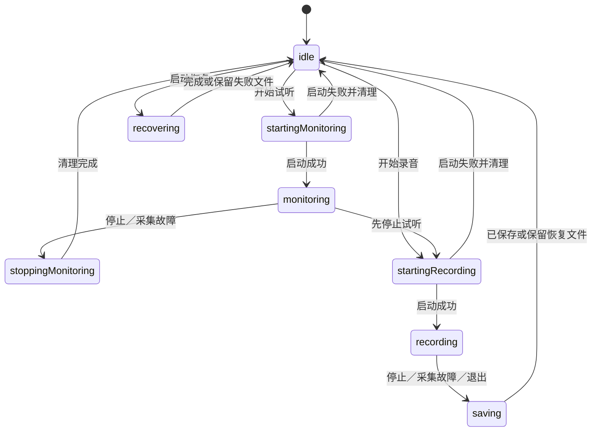

# 应用状态机清单

这里记录 DuoRec 源码中的状态机、状态所有者及约束，供维护者和代码代理共同使用。按独立生命周期分组：简单的二态事实仍可使用布尔值；只有互斥阶段才合并为枚举。Apple 和 Sparkle 已经管理的生命周期继续由其原生 API 管理。

## 核心约束

- `RecorderLifecycle` 统一定义录音、试听、恢复、设置与更新的操作条件，界面与模型入口共用这些条件。
- 录音和试听不会同时采集。试听切换到录音时，先停止试听并作废其回调，再创建录音会话。
- 在第一次异步等待之前占用状态；重复点击不能启动第二个操作。
- 每个采集回调带有会话 ID，转写异步工作带有文档 ID；只有当前操作可以修改界面状态。
- 退出可以等待准备、保存或恢复；更新结束的事件不能释放退出锁。
- 保存失败保留可恢复原文件。停止采集失败也必须尝试封装已采集的声音。

## 全部状态机

| # | 状态机 | 状态与主要转移 | 所有者／源码 | 本次处理 |
|---|---|---|---|---|
| 1 | 采集流程 | 空闲 → 启动录音 → 录音 → 保存 → 空闲；空闲 → 启动试听 → 试听 → 停止试听 → 空闲；空闲 → 恢复 → 空闲 | `RecorderLifecycle.Capture`、`RecorderModel` | 将原先的四态录音与 `isMonitoring` 合并为八个互斥状态；区分恢复和保存 |
| 2 | 应用操作锁 | 可用 → 更新 → 可用；可用／更新 → 退出；退出保存失败 → 可用 | `RecorderLifecycle.Availability`、`AppUpdater` | 更新和退出成为互斥状态；更新完成不能解锁退出；自动与手动更新同步占用操作锁 |
| 3 | 采集会话及启动错误 | 无会话 → 当前会话 → 作废；启动期间的错误暂存，启动结束后保存录音或停止试听 | `RecorderModel.sessionID`、`pendingCaptureError` | 录音和试听统一使用带会话 ID 的回调；试听故障不再只显示提示而继续保持“试听中” |
| 4 | 异步操作所有权 | 无任务 → 准备／保存任务 → 完成；重复保存等待同一个任务 | `preparationTask`、`preparationID`、`finishTask` | 准备任务增加身份检查，旧操作结束时不能清掉新操作的任务句柄 |
| 5 | 屏幕／系统声音权限 | 静默查询 → 待授权／已授权；主动请求 → 检查中 → 已授权／被拒绝／暂时不可用 | `ScreenRecordingAccess`、`refreshPermissions`、`requestScreenPermission` | 启动、激活和设置页只做无弹窗的预检查；预检查为否不覆盖已验证的 ScreenCaptureKit 授权；采集结果仍是实际依据 |
| 6 | 权限请求协调 | 用户主动请求 → 检查中 → 完成；并发请求等待同一个任务；采集结果改变版本后，旧检查结果作废 | `permissionCheckTask`、`permissionRevision` | 被拒绝后激活事件不会再请求；录音与测试输入直接走采集接口，不先额外探测一次；更新和退出期间禁止主动请求 |
| 7 | 麦克风权限与设备选择 | 未决定 → 系统授权请求 → 授权／拒绝；受限制也是未授权；当前设备缺失时选择系统默认或首个设备 | `requestPermissions`、`refreshMicrophones` | 保留系统授权生命周期及设备回退规则 |
| 8 | 音频写入器 | 缓冲 → 写入 → 结束中 → 已结束（成功／失败）；结束后忽略追加并返回缓存结果 | `DualTrackAudioWriter` | 用单一枚举替代 `hasStartedSession`、`isFinishing` 和可选结果的组合；保留锁与共享完成等待者 |
| 9 | 双来源启动汇合 | 等待来源 → 两路均到达，或缓冲达到 20 个样本 → 按最早时间开始；结束时不足阈值也会写入已有样本 | `hasSeenSystemAudio`、`hasSeenMicrophone`、`pendingSamples` | 保留；这是两个来源的独立事实，不并入全局界面状态 |
| 10 | 录音保存事务与降级 | 停止采集 → 封装原文件 → 临时 MP4 → 验证／提交 → 删除原文件；失败时尝试保存可读原轨，否则保留恢复文件 | `RecordingFinalizer`、`AudioRecordingFile`、`saveRecording`、`cleanUpAfterFailure` | 保留现有文件格式与恢复策略；准备失败后清零电平 |
| 11 | 导出及音轨提取 | 配置 → 读取／写入 → 每轨结束 → 封装完成；取消／错误 → 停止读写并清理临时文件 | `MP4RecordingExporter`、`AudioTrackExtractor` | 保留原生 reader/writer 状态及每轨完成集合；不重复实现媒体框架状态机 |
| 12 | 启动恢复 | 未检查 → 恢复中 → 检查完成；每个文件成功移出恢复目录或失败后保留 | `didCheckRecovery`、`recoverFiles`、`hasRecoveryFiles` | 恢复成为独立采集状态；更新、试听或退出期间不能启动恢复 |
| 13 | 退出握手 | 无待处理退出 → 等待准备与保存 → 回复允许／取消退出；重复退出共享等待 | `RecordingTermination`、`RecorderApplicationDelegate`、`prepareForTermination` | 保留延迟回复和保存失败取消退出；操作锁改为明确的退出状态 |
| 14 | 转写文档与任务 | 空闲 → 准备 → 转写 → 完成／失败；取消 → 空闲；新导入生成新身份 | `TranscriptionModel.phase`、`documentID`、`task` | 增加失败状态；异步边界校验文档身份与取消状态；模型入口阻止重复导入，并返回可等待的任务 |
| 15 | Whisper 模型与推理 | 未下载 → 连接 → 下载 ⇄ 暂停 → 校验 → 已安装；导入 → 校验 → 已安装；已安装 → 删除；转写：解码 → 加载模型 → 推理 → 释放；取消 → 中止计算并清理 | `WhisperModelStore`、`WhisperDownloader`、`WhisperTranscriber`、`WhisperCancellation` | 仅使用 Whisper；四个模型独立缓存，下载带任务 ID，专用原生下载任务回传真实字节进度，暂停时同步关闭文件并保留已下载字节，重启后扫描缓存并以 Range 续传，主动删除才清理未完成下载；文件大小／SHA-256 校验成功才安装；后台串行推理，C 回调读取线程安全取消标记；结果与进度校验文档及音轨身份 |
| 16 | 输出目录与访问范围 | 默认目录／恢复书签 → 有效或过期书签 → 更新／回退；获得安全范围 → 执行操作 → 释放 | `chooseOutputFolder`、书签恢复及安全范围方法；转写任务的 `defer` | 目录选择前和面板返回后均检查可编辑条件；更新期间禁用设置，避免操作中更换目录 |
| 17 | 更新时间与录音计时 | 更新器：未绑定 → 已绑定 → 可检查／不可检查 → 更新周期；计时器：停止 → 运行 → 取消 | `AppUpdater.controller`、Sparkle 发布属性；`elapsedTask` | 更新操作接入共享锁；保留 Sparkle 自身可用性和录音计时规则 |
| 18 | 导航、转写呈现与复制反馈 | 导航：录音／转写／语言识别及侧栏展开状态；文档：未导入／普通文本／来源时间线；过滤：全部／系统／麦克风；选区：空／有效；复制：无提示／成功／失败 → 三秒后消失 | `ContentView`、`TranscriptionView`、`TranscriptTextView.Coordinator`、`CopyFeedback` | 同名文件重新导入也依据文档 ID 清除选区和复制反馈；保留过滤、编辑权限及复制超时取消机制 |

告警的“无消息／有消息／关闭”由各模型的可选 `errorMessage` 驱动，属于上述流程的呈现结果。最近保存 URL、保存结果、恢复文件提示和电平值属于数据或结果，不再另设一套流程状态。

## 采集状态图



启动成功前收到的故障会先暂存，随后从 `recording` 进入保存或从 `monitoring` 进入停止。应用操作锁与此图正交：退出可以等待图中的当前操作，但不允许开始新操作。

## 回归验证

在项目根目录运行：

```sh
sh Checks/run.sh
```

这组检查编译真实模型，穷举 8 个采集状态 × 3 个应用操作锁状态，并验证无弹窗的启动／激活／设置状态查询、主动授权去重、拒绝后不重新请求、更新／退出期间的模型入口、重复导入、取消后的旧文件检查、Whisper 导入与缓存、推理取消、新导入隔离、失败状态、同名文档身份以及重复退出。文件探测由可控替身完成，不会申请采集权限或下载语音模型；首次运行需下载构建用的 Whisper 引擎。

现有本地回归检查还验证了权限结果分类、退出等待与保存失败、选区边界、来源时间线和合成音频保存。录音安全检查覆盖默认混音播放、原始 AAC 数据保留、来源隔离、旧格式、重名保护、重复／并发结束、空录音、单路来源、延迟开始音轨和强制结束测试子进程后的文件恢复。

完整 Xcode Debug 构建及上述检查已通过。实际设备权限弹窗、真实录音设备及 Sparkle 安装更新仍需在正常桌面会话进行人工验证；自动检查没有采集真实录音或安装更新。
